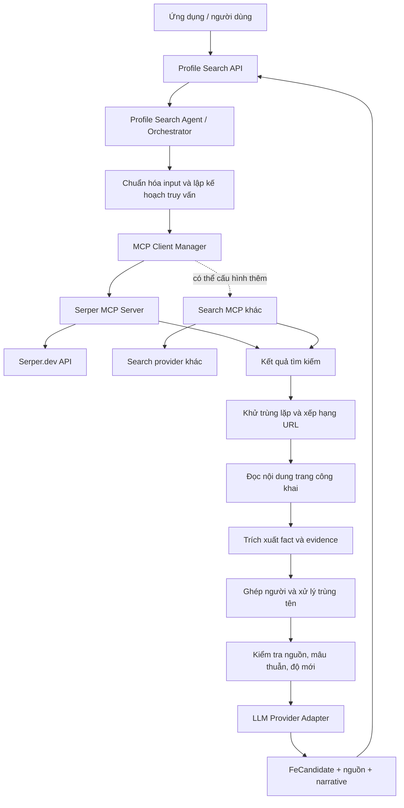
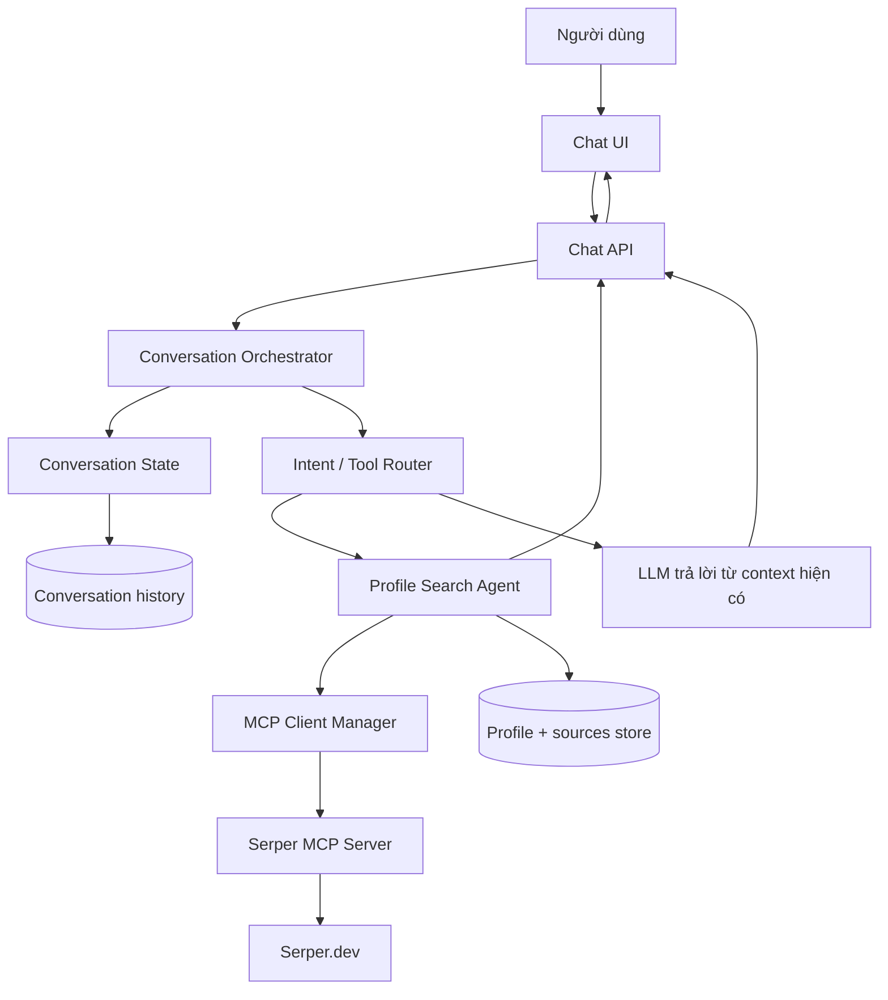

# Kiến trúc Agent tìm kiếm hồ sơ công khai

## 1. Mục tiêu

Xây dựng agent nhận tên và các tín hiệu nhận diện tùy chọn, tìm thông tin hồ sơ công khai qua một hoặc nhiều search MCP server, đối chiếu nguồn, phân biệt người trùng tên và trả về hồ sơ có dẫn chứng.

Agent là **MCP client** đối với các công cụ tìm kiếm. Serper.dev là provider tìm kiếm ban đầu, được truy cập thông qua một MCP server bọc Serper API. LLM hỗ trợ lập kế hoạch, trích xuất, phân giải ứng viên và viết phần mô tả; dữ kiện phải gắn với nguồn.

Hệ thống được công bố cho client qua **HTTP API thông thường**. MCP chỉ dùng ở phía agent để kết nối search providers; Profile Search không phải MCP server.

## 2. Sơ đồ tổng thể



## 3. Thành phần

### 3.1 Profile Search API

Nhận request từ giao diện hoặc hệ thống tích hợp. Tên là trường bắt buộc; các trường khác giúp tìm và phân biệt người trùng tên.

```json
{
  "name": "Nguyễn Văn A",
  "location": "Hồ Chí Minh",
  "education": "Đại học Y",
  "jobTitle": "Founder",
  "company": "Công ty X",
  "field": "fintech",
  "platforms": ["linkedin", "github"],
  "includeImages": false
}
```

API hỗ trợ hai chế độ:

- **Đồng bộ:** xử lý và trả kết quả trong một request khi lượt tìm kiếm ngắn.
- **Bất đồng bộ:** trả `searchId`, để client truy vấn trạng thái và lấy kết quả sau khi hoàn tất.

### 3.2 Agent Orchestrator

Điều phối một lượt tìm kiếm, nhưng không gọi trực tiếp Serper REST API. Mọi truy vấn tìm kiếm đi qua MCP Client Manager.

Trách nhiệm:

1. Chuẩn hóa input và xác định thông tin phân biệt có sẵn.
2. Tạo search plan với số truy vấn và ngân sách hữu hạn.
3. Gọi các search MCP tools theo kế hoạch.
4. Gom và khử trùng lặp kết quả.
5. Chọn URL cần đọc và trích xuất facts có evidence.
6. Phân nhóm ứng viên, đánh giá xung đột và mức khớp.
7. Tạo kết quả `FeCandidate` và narrative dựa trên facts đã kiểm tra.

Mỗi job nên có timeout, số lần retry, giới hạn kết quả/URL, giới hạn token và ngân sách search credits. Ghi lại truy vấn, MCP server/tool được gọi, thời gian và trạng thái lỗi để phục vụ vận hành.

### 3.3 Search Planner

Tạo các truy vấn ngắn, có mục tiêu từ input. Ví dụ:

```text
"Nguyễn Văn A" "Công ty X"
"Nguyễn Văn A" fintech founder
site:linkedin.com/in "Nguyễn Văn A" fintech
site:github.com "Nguyễn Văn A"
```

Nhóm truy vấn có thể gồm hồ sơ nghề nghiệp/tổ chức, URL profile theo nền tảng, website chính thức/bài báo/tác phẩm, và hình ảnh nếu tính năng được bật. Planner nên ưu tiên tín hiệu phân biệt đã có và chỉ gọi nền tảng liên quan; không tạo hàng loạt truy vấn cho mọi field trong mọi trường hợp.

### 3.4 MCP Client Manager và search MCP servers

MCP Client Manager quản lý cấu hình/kết nối đến MCP servers, khám phá tools và input schema, thực hiện tool calls, chuẩn hóa lỗi và kết quả.

**Serper MCP** là connector đầu tiên. Serper.dev cung cấp REST API; MCP server chuyển lời gọi tool thành request đến Serper và trả kết quả về agent. Các wrapper bên thứ ba hiện có gồm [garylab/serper-mcp-server](https://github.com/garylab/serper-mcp-server) và [postfix/serper-mcp](https://github.com/postfix/serper-mcp). Trước khi dùng cần xem mã nguồn, license, cách lưu API key, phiên bản phụ thuộc và transport. Có thể tự viết wrapper nhỏ để kiểm soát hoàn toàn.

Serper không nên bị gắn cứng vào business logic. Search adapter nên dựa trên tool/schema đã khai báo, để có thể thêm MCP server tìm kiếm khác bằng cấu hình.

Transport gợi ý:

- `stdio` cho phát triển cục bộ hoặc MCP server chạy cùng máy.
- `Streamable HTTP` cho MCP server từ xa; cần xác thực và giới hạn truy cập.

### 3.5 Đọc trang công khai

Search MCP thường trả kết quả SERP như tiêu đề, URL, snippet và metadata. Snippet là manh mối để chọn trang, không mặc nhiên là bằng chứng đủ cho mọi trường.

Sau search, cần một lớp đọc URL công khai để lấy nội dung trang và metadata. Đây có thể là dịch vụ nội bộ hoặc MCP tool riêng. Lớp này cần áp dụng timeout/giới hạn dung lượng/cache; lưu URL gốc, thời gian thu thập, tiêu đề và đoạn trích liên quan; đánh dấu nguồn chưa đọc được nếu trang bị chặn.

### 3.6 Fact extraction và entity resolution

LLM trích xuất facts riêng từ từng nguồn trước khi viết profile. Mỗi fact chứa giá trị, nguồn, evidence và thời điểm quan sát. Sau đó mới hợp nhất facts và phân giải danh tính.

Entity resolution dùng các tín hiệu như:

- Mức khớp tên và biến thể tên.
- Công ty, chức danh, ngành, trường học và địa điểm.
- Username hoặc URL profile.
- Liên kết chéo giữa website chính thức, profile và báo chí.
- Chất lượng và tính độc lập của các nguồn.

Nếu có nhiều ứng viên hợp lý, giữ thành các candidate riêng hoặc trả trạng thái cần làm rõ. Không gộp dữ liệu chỉ vì chúng cùng nhắc một tên.

`confidenceScore` nên được tính từ tín hiệu có thể giải thích, không dùng nguyên con số LLM tự đưa ra. Có thể bắt đầu bằng điểm thành phần: name match, distinguishing attributes, source quality, cross-source agreement và conflict penalty.

### 3.7 LLM Provider Adapter

Tách LLM khỏi orchestration bằng interface chung:

```text
LLMProvider.planQueries(input, limits)
LLMProvider.extractFacts(source, schema)
LLMProvider.resolveCandidates(candidates, input)
LLMProvider.writeNarrative(verifiedFacts, schema)
```

Provider hiện tại có thể là Yescale với model Gemini mà ứng dụng đang cấu hình. Model ID, endpoint, API key, timeout và generation parameters phải nằm trong cấu hình/secret manager, không hard-code. Các provider khác có thể thêm sau mà không đổi search MCP interface.

Dùng structured output để ép định dạng JSON, nhưng validate thêm ở ứng dụng: schema-valid không đồng nghĩa nội dung đúng hoặc có căn cứ.

## 4. Luồng xử lý chi tiết

1. **Nhận input:** validate tên, loại bỏ giá trị rỗng, chuẩn hóa danh sách nền tảng.
2. **Tạo job:** sinh `searchId`, đặt limits và lưu trạng thái `queued`/`running`.
3. **Lập truy vấn:** tạo truy vấn theo tín hiệu phân biệt và nền tảng cần tìm.
4. **Gọi MCP:** gọi search tools qua MCP Client Manager; lưu provider, tool, query và kết quả thô.
5. **Chuẩn hóa:** chuẩn hóa URL, bỏ tracking parameters, deduplicate và xếp hạng trang.
6. **Đọc nguồn:** lấy nội dung công khai từ URL tốt nhất, trong giới hạn.
7. **Trích xuất facts:** trích xuất dữ kiện có dẫn chứng; giữ mâu thuẫn thay vì tự chọn một bên.
8. **Ghép người:** tạo candidate clusters, tính điểm khớp và ghi chú điểm chưa chắc chắn.
9. **Kiểm tra:** áp dụng quy tắc nguồn, freshness, xung đột và trạng thái từng trường.
10. **Tổng hợp:** viết narrative, career arc và tags chỉ từ facts đủ căn cứ.
11. **Trả kết quả:** trả JSON `FeCandidate`, evidence, sources, field statuses và job status.

## 5. Hợp đồng dữ liệu đề xuất

### Source

```json
{
  "id": "src_102",
  "title": "Trang giới thiệu nhân sự",
  "url": "https://example.com/about/person",
  "snippet": "...",
  "sourceType": "official_website",
  "provider": "serper",
  "query": "...",
  "retrievedAt": "2026-10-08T10:00:00Z",
  "contentStatus": "fetched"
}
```

### Fact

```json
{
  "field": "company",
  "value": "Công ty X",
  "sourceIds": ["src_102"],
  "evidence": ["Đoạn văn công khai hỗ trợ dữ kiện"],
  "confidence": 0.86,
  "observedAt": "2026-10-08T10:00:00Z"
}
```

### FeCandidate (rút gọn)

```json
{
  "displayName": "Nguyễn Văn A",
  "headline": "Founder tại Công ty X",
  "confidenceScore": 0.78,
  "disambiguationNote": "Khớp công ty và lĩnh vực; địa điểm chưa được xác nhận.",
  "fields": {
    "company": {
      "value": "Công ty X",
      "sourceIds": ["src_102"],
      "confidence": 0.86,
      "status": "found"
    }
  },
  "socialProfiles": [
    {
      "platform": "linkedin",
      "url": "https://...",
      "sourceIds": ["src_103"],
      "confidence": 0.81
    }
  ],
  "sources": [],
  "photos": [],
  "narrative": "...",
  "careerArc": [],
  "tags": []
}
```

Trạng thái field khuyến nghị: `found`, `not_found`, `not_checked`, `conflicting`, `restricted`. UI nhờ đó phân biệt “không tìm thấy” với “chưa kiểm tra” và “các nguồn đang mâu thuẫn”.

## 6. HTTP API cho client

Client gọi Profile Search qua HTTP API thông thường. API không dùng giao thức MCP:

- `POST /v1/people-search` — `mode: "deep"` (search + LLM) trả kết quả trực tiếp, hoặc `202` kèm `searchId` khi chạy lâu; `mode: "preview"` chỉ search, không LLM.
- `GET /v1/people-search/{searchId}` — `202` khi đang chạy, kết quả khi xong.

Các route này gọi vào cùng Profile Search Orchestrator. Có thể dùng REST/JSON và SSE hoặc WebSocket cho cập nhật tiến độ nếu giao diện cần streaming; không cần dựng Profile Search MCP Server.

## 7. Quản lý job, cache và quan sát vận hành

Với lượt tìm kiếm dài, dùng job store để lưu `searchId`, input đã chuẩn hóa, trạng thái, kết quả trung gian, lỗi và thời điểm cập nhật. Có thể dùng hàng đợi nền khi cần tăng tải; MVP có thể chạy trong process nếu lượt tìm nhỏ và có timeout.

Cache theo query/provider/locale trong thời gian ngắn để tránh tiêu credits lặp lại. Không cache vô thời hạn vì profile, công việc và follower thay đổi. Lưu `retrievedAt` để hiển thị thời điểm dữ liệu được tìm.

Log metadata vận hành (provider/tool, latency, số kết quả, cost/credits, error code); không ghi API keys hoặc nội dung nhạy cảm không cần thiết.

## 8. Bảo mật và giới hạn dữ liệu

- Lưu Serper key và LLM key trong secret manager hoặc biến môi trường phía server.
- Không gửi secrets vào prompt hoặc trả về client.
- Xác thực MCP server từ xa và giới hạn tool access theo ứng dụng/người dùng.
- Chỉ xử lý thông tin công khai phù hợp; không vượt đăng nhập, paywall hoặc quyền riêng tư.
- Không suy đoán tuổi, email, số điện thoại, quốc tịch hay địa chỉ khi không có nguồn rõ ràng.
- Không dùng profile tổng hợp cho quyết định có ảnh hưởng lớn nếu không có quy trình xác minh phù hợp.
- Ảnh tìm được qua image search là gợi ý về nơi ảnh xuất hiện, không tự xác nhận danh tính. Tìm bằng khuôn mặt nên là tính năng riêng, có kiểm soát và căn cứ sử dụng phù hợp.

## 9. Lộ trình triển khai

### Giai đoạn 1: MVP tìm và tổng hợp

- Profile Search API, Orchestrator và job status.
- MCP Client Manager kết nối một Serper MCP server.
- Web queries theo tên và tín hiệu phân biệt.
- URL normalization, deduplication và giới hạn số trang.
- Fact extraction có evidence, entity resolution cơ bản và `FeCandidate` JSON.

### Giai đoạn 2: Độ tin cậy và khả năng thay provider

- Thêm nguồn search MCP khác qua cấu hình.
- Tối ưu xếp hạng nguồn, xử lý mâu thuẫn và freshness.
- Bổ sung LLM provider adapter và structured output validation.
- Cache, retry, cost tracking và quan sát lỗi.

### Giai đoạn 3: Tích hợp mở rộng

- Mở rộng HTTP API cho client/AI client ngoài; giữ MCP ở phía search-provider connectors.
- Hỗ trợ profile URLs, image search và nền tảng bổ sung.
- Bổ sung xác thực, quotas, audit log, tenant isolation và quản trị dữ liệu.

## 10. Quyết định kiến trúc chính

1. Agent dùng MCP client để gọi công cụ search; Serper MCP là connector đầu tiên.
2. Search provider và LLM provider là hai adapter độc lập, có thể thay riêng.
3. Facts và evidence được tạo trước narrative; mọi field quan trọng truy ngược được về nguồn.
4. Không ghép người nếu thiếu tín hiệu phân biệt; hỗ trợ nhiều candidate và trạng thái chưa chắc.
5. Profile Search được công bố bằng HTTP API; MCP chỉ là giao diện kết nối từ agent tới các search providers.

## 11. Mở rộng thành giao diện chat

Kiến trúc hỗ trợ chat bằng cách thêm **Chat API/UI và Conversation Orchestrator** ở phía trước Profile Search Agent. Search pipeline vẫn là một chức năng con mà chat có thể gọi khi cần tra cứu hoặc làm mới thông tin.



### 11.1 Phân chia trách nhiệm trong chat

- **Chat UI:** hiển thị hội thoại, trạng thái đang tìm kiếm, kết quả, nguồn và câu hỏi cần người dùng làm rõ.
- **Chat API:** nhận `conversationId`, tin nhắn mới và trả lời dạng stream hoặc message hoàn chỉnh.
- **Conversation Orchestrator:** quyết định trả lời từ hồ sơ đã có, gọi tìm kiếm mới, hoặc hỏi thêm để phân biệt người trùng tên.
- **Profile Search Agent:** thực hiện search pipeline đã mô tả ở trên; không quản lý lịch sử chat.
- **Conversation State:** giữ tham chiếu đến candidate/profile đang nói tới, tiêu chí người dùng đã xác nhận và các search job liên quan.
- **LLM:** diễn giải câu hỏi và tạo câu trả lời có dẫn nguồn; không được xem lịch sử chat là bằng chứng cho dữ kiện thực tế.

### 11.2 Luồng hội thoại ví dụ

1. Người dùng: “Tìm Nguyễn Văn A.”
2. Chat Orchestrator không có đủ tín hiệu phân biệt, nên chạy tìm kiếm sơ bộ.
3. Agent tìm thấy nhiều candidate và trả thông tin phân biệt ngắn, kèm nguồn.
4. Chat hỏi: “Bạn muốn người làm ở Công ty X hay giảng viên tại Đại học Y?”
5. Người dùng chọn một candidate; Conversation State lưu `selectedCandidateId` và tiêu chí đã xác nhận.
6. Người dùng hỏi tiếp: “Người này học ở đâu?”
7. Router tra facts và evidence của candidate đã chọn. Nếu đã có dữ kiện đủ mới, trả lời luôn; nếu thiếu, chạy search bổ sung có mục tiêu.
8. Câu trả lời hiển thị nguồn hỗ trợ cho thông tin vừa nêu.

### 11.3 Dữ liệu hội thoại

Tách dữ liệu chat khỏi dữ liệu hồ sơ:

```json
{
  "conversationId": "conv_123",
  "messages": [],
  "selectedCandidateId": "candidate_456",
  "confirmedConstraints": {
    "company": "Công ty X"
  },
  "searchIds": ["search_789"],
  "updatedAt": "2026-10-08T10:30:00Z"
}
```

Lịch sử hội thoại giúp hiểu đại từ như “người này”, “còn học vấn thì sao” hoặc “tìm thêm GitHub”. Nó không làm tăng độ tin cậy của một fact. Fact vẫn cần evidence trong Profile/Source store.

### 11.4 Phân loại yêu cầu và quyết định gọi tool

Router có thể phân loại mỗi lượt thành:

- `answer_from_context`: trả lời từ facts đã có, kèm nguồn.
- `refine_identity`: người dùng bổ sung thông tin để chọn đúng candidate.
- `search_profile`: bắt đầu tìm người mới.
- `search_more`: tìm bổ sung một field hoặc nền tảng còn thiếu.
- `compare_candidates`: so sánh các candidate đã tìm.
- `clarify`: hỏi người dùng khi thiếu tiêu chí quan trọng hoặc còn nhiều người trùng tên.

Tool call nên có giới hạn. Không chạy lại toàn bộ search chỉ vì có câu hỏi tiếp nối nếu dữ liệu hiện có đã trả lời được câu hỏi.

### 11.5 API khi có chat

Chat UI gọi Profile Search qua HTTP API. Có thể giữ các endpoint ở mục 6, đồng thời thêm endpoint chat:

- `POST /v1/conversations/{conversationId}/messages` — gửi tin nhắn mới.
- `GET /v1/conversations/{conversationId}/messages` — lấy lịch sử hội thoại.
- `GET /v1/conversations/{conversationId}/events` — tùy chọn, nhận trạng thái/response streaming qua SSE.

Conversation Orchestrator gọi Profile Search Agent nội bộ khi cần tìm mới hoặc tìm bổ sung. Không cần truyền lịch sử chat qua một MCP server của sản phẩm. Search Agent vẫn gọi search providers qua MCP Client Manager.

### 11.6 Streaming và trạng thái

Chat API có thể stream các trạng thái tiến trình như `planning`, `searching`, `reading_sources`, `verifying` và `complete` qua SSE hoặc WebSocket. Chỉ hiển thị trạng thái hoặc kết quả đã có; không hiển thị suy đoán tạm thời như facts đã xác nhận.

### 11.7 Bảo vệ ngữ cảnh và quyền riêng tư

- Ràng buộc mỗi conversation với người dùng/tenant sở hữu nó.
- Không dùng candidate đã chọn trong conversation khác nếu không có thao tác chia sẻ rõ ràng.
- Hỗ trợ xóa hội thoại và dữ liệu cache theo chính sách lưu trữ.
- Tách thông tin người dùng tự cung cấp khỏi facts tìm thấy trên web; lưu provenance riêng.
- Khi người dùng sửa nhận dạng (“không phải người ở Công ty X”), cập nhật lựa chọn và chạy lại bước ghép candidate nếu cần, không sửa nguồn gốc facts.

## Tài liệu tham khảo

- [MCP server overview (OpenAI Developers)](https://developers.openai.com/plugins/concepts/mcp-server)
- [MCP transports](https://github.com/modelcontextprotocol/modelcontextprotocol/blob/main/docs/specification/2025-03-26/basic/transports.mdx)
- [Serper MCP wrapper: garylab](https://github.com/garylab/serper-mcp-server)
- [Serper MCP wrapper: postfix](https://github.com/postfix/serper-mcp)
- [Gemini Structured Outputs](https://ai.google.dev/gemini-api/docs/structured-output?hl=en)
